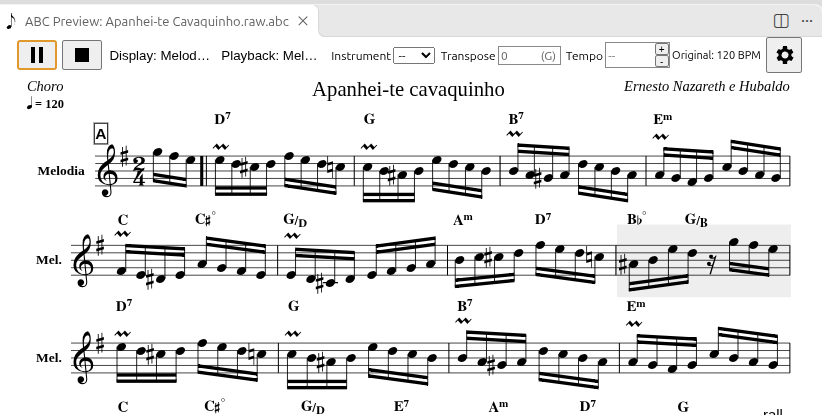
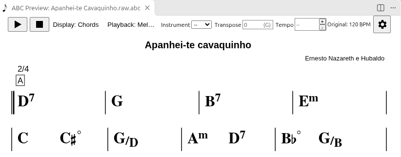

# ABC Notation Support

ABC sheet music, chord grids and playback in VS Code.

## Features

### 🎼 Instant ABC Music Notation Preview

Open an `.abc` file and click the note icon to see your sheet music.

### ⚡ Live Updates

Your sheet music updates as you edit.

### 📝 Syntax Highlighting

Clear, colorful highlighting for ABC notation.

### ▶️ Play Your Tunes

Listen with live tempo and voice controls, and subtle measure tracking.

### 🔍 Selection-Based Playback

Click and drag across notes or measures to play just that passage.

### Chord Grids

Switch to a compact chord-only view with optional repeated-measure symbols.

### Personal Preferences

Save voice choices, transposition and instrument notation without changing your ABC source.

### 🗂️ Shared ABC Settings

Reuse your library's notation settings with `.abcconfig` files and [abctools](https://github.com/laurent-yin/abctools).

### 📦 Integrated with abc2svg

Powered by abc2svg for music engraving and playback.

## Learn more

[Preview & preferences](docs/preview-guide.md) ·
[Development](docs/development.md) ·
[Release notes](CHANGELOG.md)
