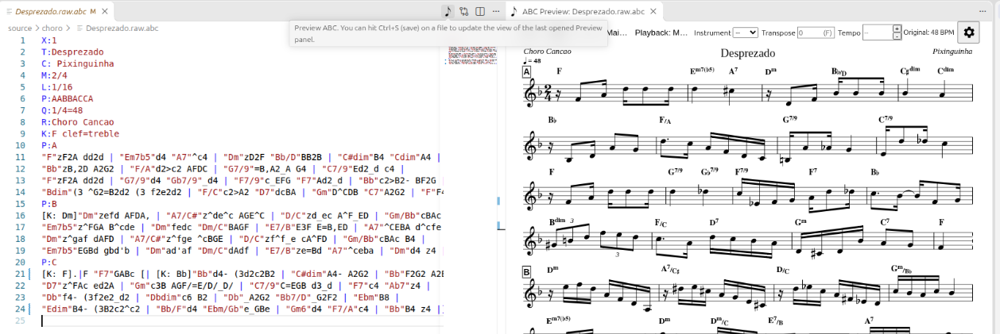
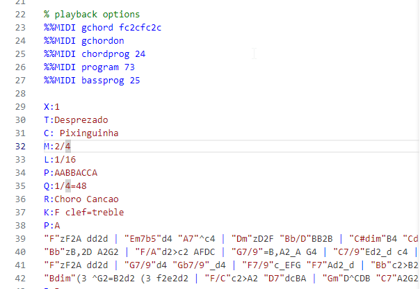
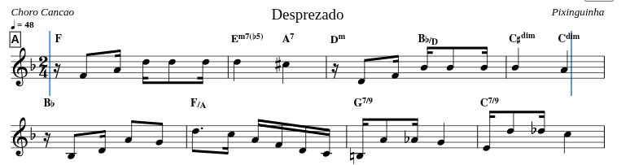

# vscode-abc-music-editor
A VS Code extension to add support to ABC Music notation using abc2svg.

## Features

### 🎼 Instant ABC Music Notation Preview  
  Preview your ABC music files as beautiful sheet music directly in VS Code with a single click on the note icon.
  


### ⚡ Live Updates  
  The preview panel updates automatically when you make changes to your `.abc` file, so you can see changes in real time.

### 📝 Syntax Highlighting
  Enjoy clear, colorful syntax highlighting for ABC notation, making your `.abc` files easier to read and edit.


### ▶️ Play Your Tunes  
  Listen to your ABC music directly in VS Code with integrated playback—perfect for quickly checking your compositions.

### 🔍 Selection-Based Playback  
  Play only the selected portion of your ABC file. To select, click on a note and drag in direction to another note.



### 🗂️ Store your frequently-used ABC directives in separate files
  Support through [abctools](https://github.com/laurent-yin/abctools) of .abcconfig files, to store your %%directives in a common place for each folder.
  
  See [choro-abc](https://github.com/laurent-yin/choro-abc) for a real-world example of a repository that uses abctools to manage and export ABC music notation files.

### 📦 Integrated with abc2svg
  Leverages the power of abc2svg library for accurate rendering and advanced ABC features.

## Personal preview preferences

Open the gear on the playback toolbar to change personal preferences. Its
scrollable panel overlays the score rather than taking up extra score height.
Click outside it or press Escape to close it. Preference errors reopen the panel.

The header shows compact **Display** and **Playback** summaries. Click either
to expand its voice checkboxes. Voice labels use declared names with IDs for
clarity. **Chords** is a checkbox in both menus: chord labels for Display,
generated accompaniment for Playback. Each change saves a file preference;
unchecking every voice really hides or mutes every voice.
When Display Chords is enabled, chord labels prefer a selected staff whose
authored chord position is visible, preserving above/below placement. If only
chord-hidden staves are selected, the preview shows the chords above a selected
staff instead. Labels are deduplicated per notation transposition, not assigned
to a hidden chord position. Source chord visibility and playback are unchanged.

### Chord-only grids

In **Display**, uncheck every voice and leave **Chords** checked to show a
compact chord grid instead of empty staves. Re-enable a voice to return to the
normal score. Unchecking Chords as well hides the music entirely.

The **Chord source** dropdown is in the **Display** menu, only when Chords is
the only selected display item; it never occupies the header. Its default is the first
declared voice, even if another voice contains chords. An explicit choice is
saved per file. A voice with no chords shows a message rather than silently
using another harmony. In tunebooks, a saved source missing from a particular
tune also shows a message. Removed file-wide source IDs reset with a warning.
The grid follows the source voice's instrument key (inheriting the file/default)
and the song transposition. Its source choice does **not** change the generated
audio accompaniment or stop ongoing playback.

In the **gear → Chord grid defaults** section:

- **ABC source lines** (default) keeps the source voice's musical line breaks.
  Long lines scale to fit the preview width without horizontal scrolling.
- **Compact automatic wrap** packs measures into the available width and
  reflows on resize, keeping structural boundaries.
- **Replace repeated measures with %** (enabled by default) replaces an entire
  measure with the same harmonic rhythm as its predecessor. It never replaces
  individual repeated chord labels or removes annotations. Section/repeat and
  alternative-ending boundaries restate the harmony.
- **Show text instructions (a tempo, rall., etc.)** is disabled by default.
  Enable it to retain authored performance text in grids. This is a general
  preference, not a per-file override. Fermatas and note ornaments remain hidden.

These are general preferences only, not per-file controls in the main toolbar.
The entire chord-only page, including titles and all tunes, scales to the
space below the toolbar without horizontal or vertical scrollbars or clipping.
Very long grids therefore use smaller text; source-line groups are preserved.
Chord labels use bundled FreeSerif for a compact, engraved appearance, with one
shared page scale rather than separate line-by-line scaling. All roots have
the same size; qualities and extensions are raised at 75% of that size, while
slash basses sit slightly lower. For example, `Bm7b5` displays as B with
`m7(♭5)` raised, and `D/F#` uses a lowered slash and F♯ bass. This is display-only:
authored chord labels, transposition, repeated-measure comparisons and audio
remain unchanged. Unrecognized labels such as `N.C.` stay literal.
Chord widths are measured in the loaded font before layout, including extensions
and basses, so complex labels remain separated in narrow views. The font is
packaged locally and works offline; it does not depend on device-installed fonts.
FreeSerif is distributed under GPL-3-or-later with the Special Font Exception;
its notices, license and rebuild instructions are in
[lib/FreeSerif-NOTICE.txt](lib/FreeSerif-NOTICE.txt), with the corresponding
upstream source archive included under `vendor/`.
Grids retain measure/repeat bars, parts, endings, meter changes and navigation
marks. Performance text is optional; fermatas are omitted. Chords within a measure
keep their rhythmic positions. Incomplete opening measures (pickups) at the start
of each part are omitted entirely, without leaving empty cells. Their part labels,
instructions and repeat starts move to the next visible measure. Other incomplete
measures, such as a part's ending, retain their chords. This never changes the
source or full-tune playback.
Click/drag cells to select complete measures for playback; `%` cells retain
their musical intervals. Playback highlights the current measure.
An internal measure of an authored multi-measure rest may have no standalone
playback event; its tooltip and preview notices explain when full-tune playback
is needed instead.

The grid uses abc2svg's parsed model, not an ABC text parser; bundled native
`grid` modules remain unchanged. Note ornaments and internal decoration names
(such as `uppermordent`) are omitted, not printed in brackets. Authored text
indications such as `a tempo` are shown only when enabled; structural navigation
marks remain visible.

Global JSON settings are `"chordGrid": {"layout": "source",
"repeatMeasures": true, "showTextInstructions": false}` under `defaults`;
use `"compact"` for automatic wrap.
The file-only source override is `"chordSourceVoiceId": "melody"`.

The extension currently consumes the included `vendor/abctools-0.2.5.tgz`
package so this feature builds without publishing the shared-library changes
or depending on an absolute local checkout. To refresh it after changes in
the adjacent abctools checkout, run its tests, then `npm pack ../abctools
--pack-destination vendor` and reinstall the resulting archive. Browser
regressions run with `npm run test:grid-browser` after `npx playwright install
chromium`; an existing Chrome executable can instead be selected with
`PLAYWRIGHT_CHROMIUM_EXECUTABLE_PATH`.

### Other preview preferences

In the gear panel, set **By default, hide voices matching** for Display and
**By default, mute voices matching** for Playback. Separate multiple patterns
with `;`, for example `*bass*; *counterpoint*`. A match against any pattern
excludes that voice. Wildcards match the entire voice ID or name ignoring
case: `*bass*` matches names containing "bass", and `?` matches one character.
Blank entries are ignored; a blank field displays/plays every voice.
Defaults have separate **Display chords** and **Play chords** checkboxes.
Saving defaults preserves existing file overrides and song transposition.

The header also contains the file's **Instrument** and **Transpose**
controls. Instrument key affects notation only, and inherits the single
**Default instrument key** in the gear menu. Its compact dropdown shows only
the instrument code (`C`, `Bb`, etc.), or `--` for source notation when no
default is set. The menu groups default and file-override choices separately;
the tooltip identifies which is active. Each voice in Display has its
own optional file-specific key override and written octave shift. A voice
without an override follows the file key, which in turn follows the default.
Transposition affects notation and sound, is always per file, and resets at 0;
there is no default song transposition. Its box shows the resulting initial
sounding key of the first tune, e.g. `-2 (Fm)` for a tune starting in G minor.
This key is independent of instrument notation and later `K:` changes;
major keys use their tonic name, minor keys use `m`, and other modes retain
their full names. **Show in Web Editor** is in the gear
menu rather than the header.

The header's **Tempo** number picker accepts any whole-number BPM from 1, with
no configured upper limit. It changes playback speed without stopping the tune
or changing pitch. Click the field for a scrollable list centered on the current
tempo, then click a BPM to select it. Scrolling reveals further values in either
direction; **Original** clears the override. Typing and the small `+`/`-` buttons
remain available. From a blank field, `+` starts at the original tempo plus 1
(and `-` at the original minus 1, with a minimum of 1). Arrow Up/Down also step
from the original tempo; Alt+Down opens the list and Escape closes it.
A blank field (`--`) uses the original tempo, labelled beside
the picker. The BPM uses the initial `Q:` beat unit (a quarter note at 120 BPM
when no tempo is specified). Each tune in a tunebook shows its own original
tempo. Later authored tempo changes scale proportionally: overriding an initial
120 BPM with 60 BPM also makes a later 90 BPM section play at 45 BPM.
Changes apply live as the player's already-scheduled notes finish.
The override is saved per file with personal preferences; clearing the picker
removes it. Tempo has no global default and never edits the ABC source.

When a previewed file changes (or is reopened), saved voice lists are rebuilt
from its current inventory. Existing IDs keep their selections; removed IDs
and stale per-voice notation overrides are dropped; new IDs follow defaults.
Renaming a voice's label keeps its choice if its ID is unchanged. Changing an
ID treats it as a new voice. Refreshes never edit the ABC source.

Display and playback voice/chord changes apply without interrupting playback.
Muted voices rejoin at the current position when enabled again, including notes
already sustaining. Instrument notation and song transposition changes also keep
playback running, preserving the current position and selection. Song
transposition retunes sustained and queued pitched notes, including accompaniment,
without changing tempo; percussion and count-in beats keep their pitch.
MIDI notes shifted outside its 0-127 pitch range are silent until shifted back.
Source edits and changing the Play tune selection still stop
playback; press Play to restart. Selection playback uses the complete audio model
even when some voices are hidden, and its range survives display changes.
Multi-tune files have a Play tune selector; saved voice filters and song shifts
are file-wide. Live mixing is implemented by the extension; bundled abc2svg
files are unchanged.

Preferences are app-managed outside your music repository by default, separately
for each workspace library. Use these Command Palette commands:

- **ABC: Choose Personal Preferences Folder**: select a directory containing
  `preferences.json`, or an empty directory where it will be created on save.
  This can be an external folder or an optional `.abcpreferences` folder.
- **ABC: Use App-managed Personal Preferences**: switch back to app storage.
- **ABC: Reload Personal Preferences**: reload after external edits or conflicts.

Switching stores does not copy or merge them. The preview shows the selected
location and whether settings come from defaults or a file override. Writes
check revisions and use an exclusive lock plus atomic replacement. A stale
`.lock` file is an explicit error; remove it only after confirming no writer is
active. Invalid/read-only/conflicting writes remain visibly unsaved.

### JSON format

```json
{
  "version": 1,
  "defaults": {
    "display": {
      "hideVoicesMatching": "*counterpoint*; *bass*",
      "chords": true
    },
    "playback": {
      "hideVoicesMatching": "",
      "chords": true
    },
    "notation": {
      "instrumentKey": "Bb"
    }
  },
  "files": {
    "collection/tune.raw.abc": {
      "display": {
        "selectedVoiceIds": ["melody"],
        "knownVoiceIds": ["melody", "bass"],
        "chords": true
      },
      "transposition": { "semitones": 2 },
      "tempo": 90,
      "notation": {
        "voices": {
          "bass": { "instrumentKey": "C", "octaveShift": 0 }
        }
      }
    }
  }
}
```

- `hideVoicesMatching` is a wildcard exclusion, not regex. No matches excludes
  nothing; `*` excludes all voices. Semicolon-separated patterns combine with
  OR, and surrounding whitespace/empty entries are ignored.
- `selectedVoiceIds` is an explicit file selection, including an empty array.
  `knownVoiceIds` records the inventory used to distinguish new and removed IDs.
- Legacy `voiceIdFilter` / `voiceIdRegexFilter` files remain readable and are
  converted to explicit file selections when previewed. Legacy regex matching
  still runs in a terminable worker with a two-second budget.
  All selects every current voice; subsequently added voices follow defaults.
- Instrument key changes notation only. C/Bb/Eb are instrument keys, not song
  destination keys. Written octave shift is independent and never changes sound.
- Song transposition changes notation and sound by -24 to +24 semitones. The
  resulting sounding key is shown. It is saved per file, never as a default.
  Enharmonic spelling currently follows abc2svg; there is no destination-key
  spelling picker.
- `tempo` is a file-only BPM override in the shared abctools preferences schema.
  Omit it for original tempo. abctools validates, resolves and serializes it;
  the extension supplies the playback UI and persists preferences to disk.
- Reset this file removes its overrides. Default controls save only the
  corresponding global settings, preserving all file overrides. New per-voice
  notation changes are file-only; saving defaults clears legacy voice-specific
  notation defaults (with a notice when those are present).

Relative paths use `/` and are relative to the workspace folder (or the document
directory outside a workspace). Moving a whole library and rebinding its store
keeps those keys; individual moves/renames may lose override associations.
Raw and generated paths are separate. There are no UUID insertions or source
rewrites. Ordinary exports and shared `.abcconfig` files are unaffected.

### Current renderer boundaries

Separate-voice staff layouts support plain selectors and static, non-nested
brace/bracket groups such as `%%score { melody bass }`. Voice selections retain
the authored staff order and groups; a group collapses when only one staff
remains. Selected voices omitted by an authored selector are appended.
Shared-staff/floating/barline operators, nested or changing layouts, layout
directives after the initial `K:`, legacy braced `%%staves` groups of more than
two voices are rejected explicitly. Voice overlays (`&` simultaneous branches)
remain part of their authored parent voice: they share its display/playback
selection and instrument notation, without separate checkboxes.
The bundled abc2svg parser includes a local correction for first-measure
overlay timing in hidden voices, preventing spurious duration errors and
extra trailing rests when a multi-branch overlay's parent is deselected.
Conflicting simultaneous harmonies, or hidden chords with no available event
at the same time in the selected staff, also produce explicit errors rather
than silently dropping or changing harmony.
Personal transforms on sources already declaring pitch/register transforms
require a confirmed source pitch basis and are not automatically guessed.
When discovery, filtering, personal transforms or projected engraving fail, the
preview retries the original content with its authored layout. A warning above
the sheet explains the failure and suggests resetting preferences, adjusting
the source when appropriate, or reporting the error. Recovery applies no
personal display/playback/chord choices, instrument overrides or transposition;
playback uses the original unfiltered music. The header identifies Original
display/playback mode. Saved preferences are not replaced by recovery settings,
and controls remain available to retry or reset unsupported personal choices.
Original-renderer diagnostics are shown alongside any recoverable sheet output.
If even the original sheet cannot render, both failure reasons are displayed.
Temporary editing errors do not disable `fit2box`: after the source becomes
valid again, the saved voice selection and fitted engraving are restored
without reloading the preview.

Source-position navigation and editor-position diagnostics are explicitly
disabled in this preview: configuration assembly, projections and fit2box do not
yet provide a composed source map. Errors are shown in the preview instead.

## Development and validation

The extension uses the published `abctools@0.2.1` npm package, including its
portable preferences and configuration APIs. No sibling checkout is required.

Development tooling requires Node.js 20.19+, 22.13+, or 24+. This does not
change the extension's VS Code runtime requirement. ESLint and TypeScript-ESLint
use a patched minimatch 11 override because their declared minimatch 10
dependencies are covered by GHSA-g3hv-75wg-m249. Revisit the override when
upstream dependencies adopt the fix. Asset copying uses Node's filesystem APIs
rather than the legacy copyfiles/glob dependency chain.

```sh
npm install
npm test
npm run test:host
```

The test suite covers the portable store and bundled renderer. `test:host`
requires the installed `code` executable and a display; it uses an isolated
profile for activation/preview/bridge smoke tests. For a local
browser harness running the actual webview scripts with an invented tune:

```sh
node test/preview-server.mjs
```

Open the printed loopback URL. The harness uses temporary personal storage and
does not load library material. It is not an extension-host integration test.